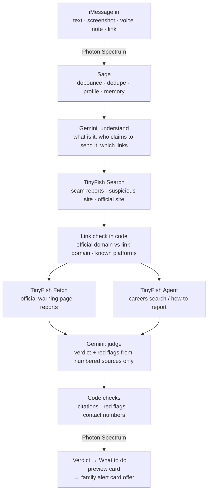

<p align="center"></p>

<h1 align="center">Sage</h1>
<p align="center"><b>Text it anything that feels off. It checks the live web and texts back a clear answer.</b></p>
<p align="center">An iMessage assistant built with <b>Photon Spectrum</b> (iMessage) + <b>TinyFish</b> (Search, Fetch and Agent).<br>TinyFish Student Bounty Drop 001: "Build Your Own AI Assistant on iMessage".</p>

---

## The moment it's built for

You're a student. A text arrives: *"Congrats! You've been selected for a Remote Data Analyst internship at Shopify, $45/hr. Reply with your SIN to start onboarding."*

It looks real enough. You don't want to miss a real offer, and you don't want to hand a stranger your SIN. So you screenshot it and send it to **Sage**.

About a minute later:

```
🔴 Scam
This fake job offer is trying to get your personal details.

🚩 No such role is listed on Shopify's real careers page
🚩 Asks you to reply with your SIN by text

What to do
1️⃣ Don't reply or send your SIN
2️⃣ Block the number and delete the text
3️⃣ Search for open jobs on shopify.com/careers yourself

📚 Sources: shopify.com, consumer.ftc.gov
Reply "links" for the full links
```

…plus a preview card of Shopify's real careers page, and an offer to send a ready-made **scam alert card** to your family.

Students get these near-daily: fake internships and recruiters, "CRA owes you a refund" texts, $1.99 parcel fees, rental deposit scams, ticket resales. The same scams reach their parents and grandparents, so Sage is written for **anyone**: plain words, no tech jargon, one clear answer.

---

## What Sage does

| | |
|---|---|
| 🔎 **Checks anything you forward** | Pasted texts, emails, DMs, links, **screenshots** and **voice notes** |
| 🧭 **Does real web work** | Searches for reports, reads the official site, and sends an agent onto the real website (e.g. Shopify's careers search) |
| 🔴🟠🟡🟢 **One clear verdict** | Scam · Be careful · Can't confirm · Looks real (fact-checks: False · Misleading · Unproven · True) |
| 1️⃣ **Steps you can follow** | What to do now, and how to check it yourself through the official app or site |
| 📚 **Real sources only** | Every source is a page TinyFish actually searched or read; reply `links` for the full URLs |
| 👨‍👩‍👧 **Family alert card** | After a scam, a short link-free warning to text a family contact (with your yes) or forward yourself |
| 🫶 **"I already clicked"** | Calm damage-control steps from official guidance, then **one check-in later**: "Did you get through the steps?" |
| 🙂 **Remembers you** | Asks your first name and city once, then remembers them, your language, your last checks and your family contact |
| 🌍 **Your language, your country** | Replies in the language you write in; searches use your country (CRA in Canada, IRS in the US…) |

---

## How Photon and TinyFish are each used

### Photon Spectrum: the iMessage layer
- **Receives** texts, links, screenshots, voice notes and bursts ("look at this" + a screenshot) as one request.
- **Feels native**: a ‼️ tapback the moment a scam arrives, a typing indicator, and **one progress bubble edited in place** as the web work runs ("🔎 Looking into this…" → "🧭 Searching Shopify's real job listings…" → "✅ Done · checked 5 sources").
- **Formats** verdicts with native bold, a **loud** bubble effect on scams and a **gentle** one on good news, a **rich link preview** of the official page, and Sage's **contact card** after onboarding.
- **Sends** the family alert as a direct iMessage, and the one-time check-in in your existing chat.

### TinyFish: the web layer (all three endpoints, each with a distinct job)
| Endpoint | Job in Sage |
|---|---|
| **Search** | Finds reports of the exact message and of the suspicious website, identifies the organisation's **real official domain**, finds its own fraud-warning and careers pages, and finds news and fact-checks for forwarded claims |
| **Fetch** | Reads those pages live (the official warning page, scam reports, fact-checks). The verdict is written only from what was read |
| **Agent** | Acts on the **real website**: for a job offer it searches the company's own careers page for the advertised role ("no such role is listed"); otherwise it finds the official way to report fraud and the real support number. Its live steps feed the progress bubble |

### Gemini (free tier): reading and writing
Reads screenshots and voice notes, works out what's being claimed, and writes the verdict **only from numbered TinyFish sources**, in the user's language.

---

## How one check works



---

## Trust rules, enforced in code (not just asked for in a prompt)

- **Never fakes a source.** Every citation must point at a page TinyFish searched or read; unknown citations are dropped. An official phone number or email is shown only if it appears on the official site or in what the agent saw.
- **A scam verdict needs evidence about *this* message.** The judge picks red flags from a fixed list (bad link, asks for personal info, asks for payment, deadline or threat, unexpected offer, role not on the real site, org says it never sends this). The code drops the ones it can disprove (e.g. "bad link" when the link check found none), and Scam / Be careful without a surviving red flag is rewritten as Can't confirm. A real Google security alert and a real salon booking text both come back 🟡 Can't confirm, not 🔴.
- **Never says "safe to click".** The strongest positive is 🟢 Looks real, always with "check it through the official app yourself".
- **Asks before anything is sent.** Adding a family contact, the invite, and every family alert each need an explicit yes. The family contact opts in themselves, and can say no.
- **Never asks for passwords, card numbers or ID numbers.** If a message contains them, Sage flags it and never repeats them. Screenshots are never stored.
- **Fails safely.** If the web or the AI is slow, Sage says so plainly, gives safe default advice, and you can reply `try again`. Sends are retried if the connection drops.

---

## Run it yourself (about 10 minutes)

**You need:** a Mac (voice-note conversion uses macOS's built-in `afconvert`; everything else also runs on Linux), [Bun](https://bun.sh), and three free keys.

1. **Photon Spectrum**: create a project at [app.photon.codes](https://app.photon.codes), add an iMessage line, and copy the **Project ID** and **Project Secret** from Settings. On the Free/Pro plan, add every phone number that will text Sage under **Users**; Sage can only message registered users.
2. **TinyFish**: create an API key at [agent.tinyfish.ai/api-keys](https://agent.tinyfish.ai/api-keys). Search and Fetch are free; the Agent uses credits.
3. **Gemini**: create a free key at [aistudio.google.com](https://aistudio.google.com).

```bash
git clone <this repo> sage && cd sage
bun install
cp .env.example .env     # put your keys in .env (never in .env.example)
bun run smoke            # checks every service responds (add --agent to test the Agent too)
bun run start            # Sage is live on your Photon iMessage line
```

**Try it without a phone**

```bash
bun run terminal                                  # chat with Sage in your terminal
bun run check "Canada Post: your parcel is on hold, pay \$1.99 at canadapost-redelivery.info"
bun run eval                                      # the full test set against the live web
```

### Settings (`.env`)

| Variable | Default | What it does |
|---|---|---|
| `SPECTRUM_PROJECT_ID`, `SPECTRUM_PROJECT_SECRET` | | Photon project credentials |
| `TINYFISH_API_KEY` | | TinyFish key |
| `GEMINI_API_KEY` | | Gemini key |
| `GEMINI_MODEL` / `GEMINI_FALLBACK_MODEL` / `GEMINI_JUDGE_MODEL` | `gemini-3.5-flash-lite` / `gemini-3.1-flash-lite` / main model | Models; every call has a timeout and switches model on overload |
| `ALLOWLIST` | empty (anyone) | Demo mode: only these numbers or emails get replies (comma-separated) |
| `CHECKS_PER_USER_PER_DAY` | `8` | Per-person daily limit (only successful checks count) |
| `AGENT_RUNS_PER_DAY` | `40` | Global cap on credit-using Agent runs |
| `CHECKIN_MINUTES` | `60` | When to check in after "I already clicked" (set `1` for a demo) |
| `SAGE_NAME`, `SAGE_MODE` | `Sage`, `imessage` | Bot name; `terminal` to run without a phone |

---

## Tested

`bun run eval` runs ten cases against the live web and prints the verdict, red flags, sources and timing:

| # | Input | Result |
|---|---|---|
| 1 | Fake Shopify internship asking for your SIN | 🔴 Scam: the Agent finds no such role on Shopify's real careers page |
| 2 | "CRA refund" text with an unofficial link | 🔴 Scam: link isn't canada.ca; CRA says it doesn't text refunds |
| 3 | Canada Post $1.99 unpaid-duty text | 🔴 Scam, with Canada Post's real number |
| 4 | A real Canada Post delivery notice | 🟡 Can't confirm / 🟢 Looks real, never "safe" |
| 5 | WhatsApp "forward this or pay $0.99" hoax | 🔴 False, citing fact-checks |
| 6 | "I got a weird email" | Asks for a screenshot (how to take one) |
| 7 | **Screenshot** of case 1 | Same as case 1, read from the image |
| 8 | "I already clicked and entered my password" | Calm steps, then a check-in |
| 9 | The Canada Post scam **in French** | 🔴 Arnaque, fully in French |
| 10 | A real Google security alert | 🟡 Can't confirm: no specific red flags |

It was also tested in real iMessage conversations (screenshots, a real salon booking text, a real Google alert, follow-up questions, "links", "try again", check-ins and alert cards), and fixed along the way. The commit history records each fix.

---

## Privacy

- Keys live only in `.env` (gitignored). No keys or personal data are in this repo; the test screenshot uses a fictional 555 number.
- Sage stores your first name, city and country, language, a short conversation history, check summaries and links, and your family contact. **Screenshots and voice notes are never stored.**
- Gemini's free tier may use inputs to improve Google's models; use a paid key for anything sensitive. Don't send passwords or card numbers. Sage flags them and never repeats them.

## Limits worth knowing

- On Photon's Free/Pro plan, Sage can only text **users registered in the Photon dashboard**, and each user may be assigned a different Sage number from a shared pool. A dedicated number (Business plan) lifts both.
- A full check takes about 30 to 90 seconds; the progress bubble shows each step meanwhile.
- Voice-note conversion needs macOS (`afconvert`).

## Project layout

```
src/index.ts        Photon loop: bursts, dedupe, profile, intents, alert cards, check-ins, retries
src/brain.ts        Gemini: understand · judge (schema-enforced) · damage control · profile; shared writing style
src/investigate.ts  TinyFish Search → Fetch → Agent, link check, red-flag and citation rules, cache
src/tinyfish.ts     Search / Fetch / Agent (streaming) wrappers, country-aware search, budgets
src/format.ts       Every message layout and all fixed copy, in one place
src/db.ts           SQLite: users, turns, checks, cache, usage, follow-ups
scripts/            smoke · check · eval (live test set) · fixtures
```

Built by Vivek Salwan for TinyFish Student Bounty Drop 001 · Photon Spectrum + TinyFish
