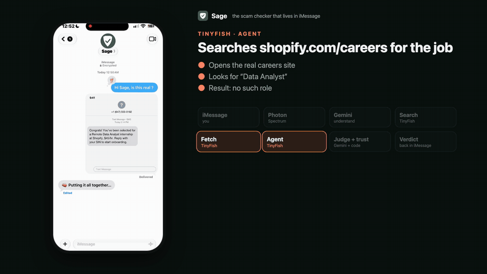
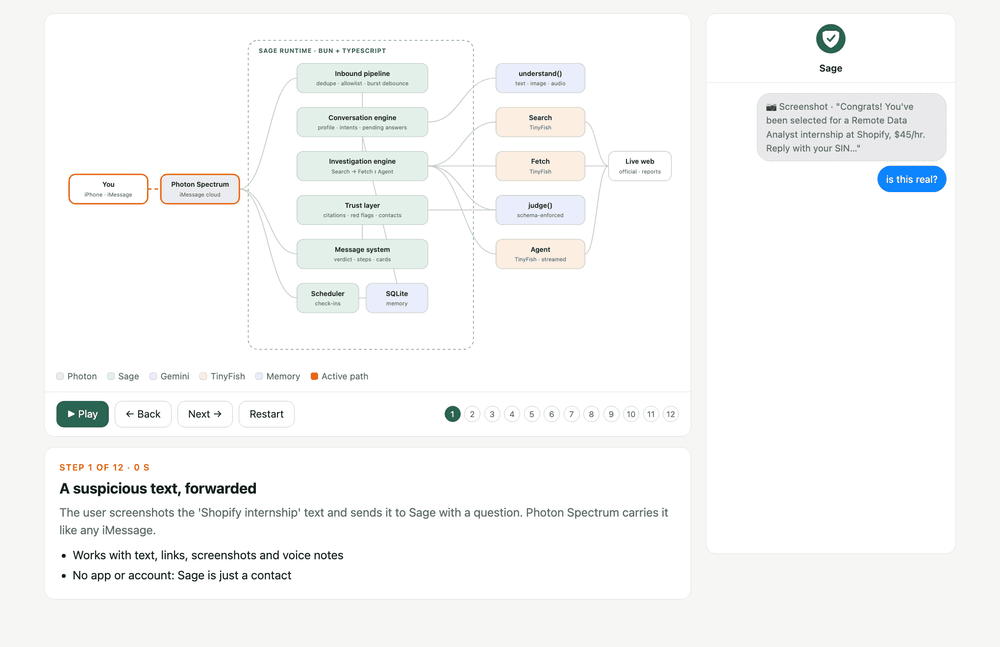
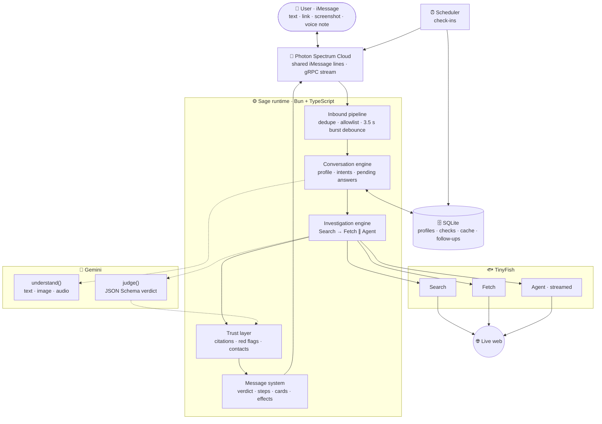
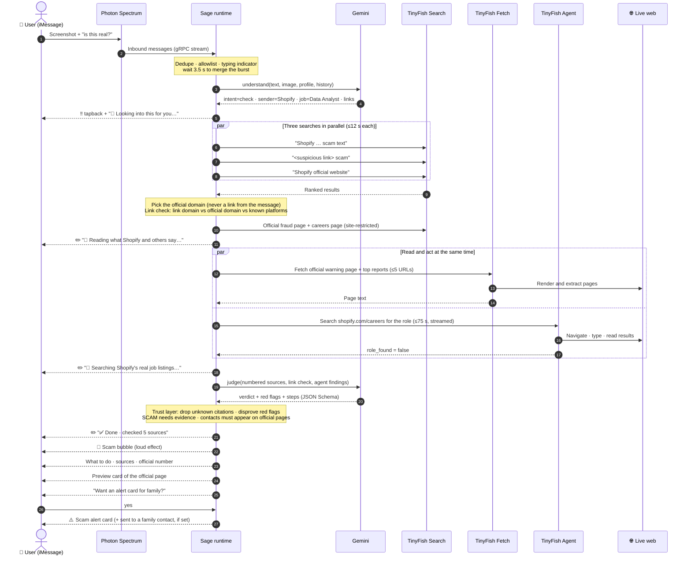
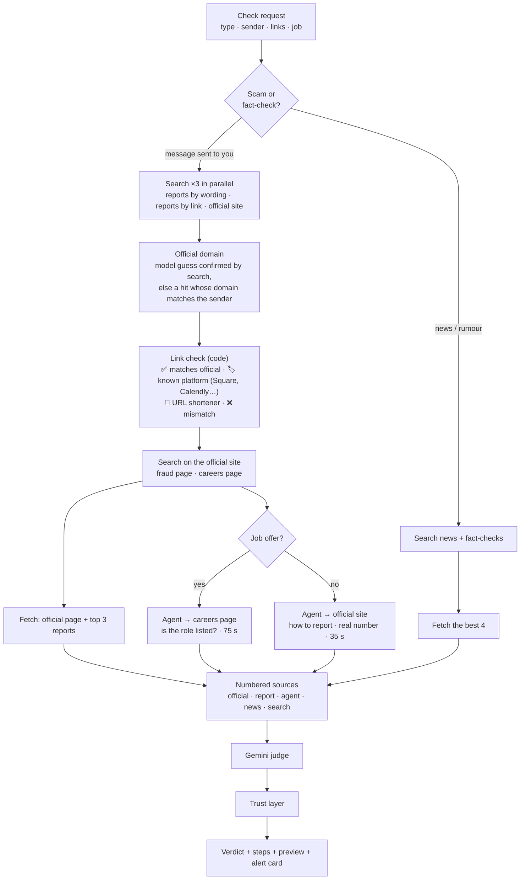
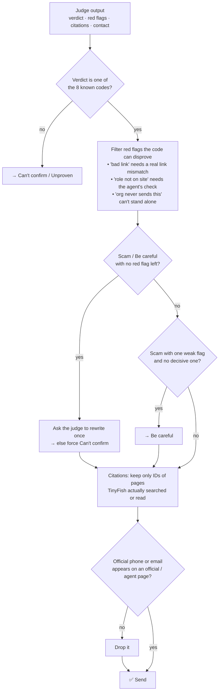
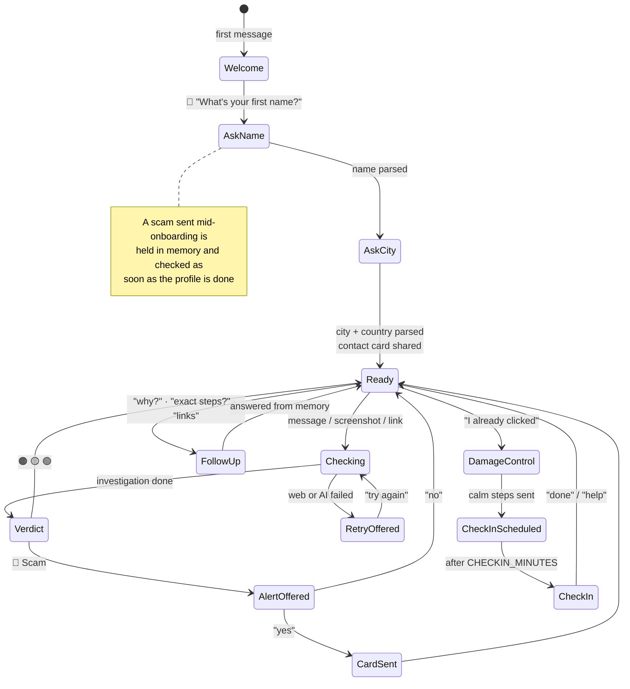
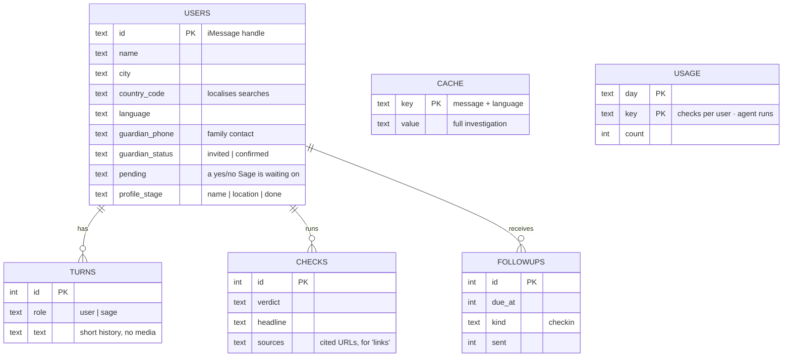

<div align="center">


# Sage

### The scam checker that lives in iMessage.

**Forward anything that feels off. Sage investigates it on the live web and texts back a clear verdict, the steps to take, and the sources it read, in about a minute.**

<br>


[**▶ Watch the demo**](https://viveksalwan2000.github.io/sage/demo.html) · [**How it works**](#-how-a-check-travels) · [**Architecture**](#-system-architecture) · [**Trust model**](#-trust-model) · [**Interactive explorer ↗**](https://viveksalwan2000.github.io/sage/architecture.html) · [**Run it**](#-quick-start)

</div>

---

## 🎬 See it in action

<div align="center">

<a href="https://viveksalwan2000.github.io/sage/demo.html">
  
</a>

**[▶ Watch the full 60-second demo (with sound)](https://viveksalwan2000.github.io/sage/demo.html)** · [Download MP4](docs/media/sage-demo.mp4)

<sub>A real iMessage conversation recorded on an iPhone. Narration is AI-generated (Gemini TTS); the side panel shows which part of the system is working at each moment.</sub>

</div>

---

## 📱 The product in one conversation

> A student gets a text: *"Congrats! You've been selected for a Remote Data Analyst internship at Shopify, $45/hr. Reply with your SIN to start onboarding."* They screenshot it and send it to Sage.

<table>
<tr>
<td width="50%" valign="top">

**What they see, live**
```
‼️  (tapback, instantly)

🔎 Looking into this for you…
📖 Reading what Shopify and others say…
🧭 Searching Shopify's real job listings…
✅ Done · checked 5 sources
```
```
🔴 Scam
This fake job offer is trying to get
your personal details.

🚩 No such role is listed on Shopify's
   real careers page
🚩 Asks you to reply with your SIN
```

</td>
<td width="50%" valign="top">

**…followed by**
```
What to do
1️⃣ Don't reply or send your SIN
2️⃣ Block the number and delete the text
3️⃣ Search jobs on shopify.com/careers
   yourself

📚 Sources: shopify.com, consumer.ftc.gov
Reply "links" for the full links
```
`[ preview card: Shopify Careers ]`
```
👨‍👩‍👧 Scams like this often reach family
too. Want an alert card you can
forward to them? Reply yes or no.
```

</td>
</tr>
</table>

Behind that minute: **three web searches, a live read of Shopify's own pages, and an AI agent that opened Shopify's real careers site and searched it for the job.** Every claim in the verdict points to a page Sage actually read.

---

## 🎯 Why it exists

Students get these near-daily: fake internships and recruiters, *"CRA owes you a refund"*, $1.99 parcel fees, rental deposits, ticket resales. The same scams reach their parents and grandparents. Checking takes know-how most people don't have in the moment, so they guess.

**Sage turns "is this real?" into a one-text habit.** No app to install and no account. It answers in plain language anyone can follow, in the app where the scam arrived.

| | Outcome |
|---|---|
| 🧭 **Real investigation, not vibes** | Every verdict comes from live web work: reports, the organisation's official site, and an agent that checks the real website |
| 🔴🟠🟡🟢 **One clear answer** | Scam · Be careful · Can't confirm · Looks real (fact-checks: False · Misleading · Unproven · True) |
| 🛡️ **Trust you can audit** | Real sources only, red flags tied to *this* message, never "safe to click", nothing sent without a yes |
| 👨‍👩‍👧 **Protects the family too** | One-tap alert cards for family, sent directly or forwarded |
| 🙂 **Feels like a person** | Remembers you, replies in your language, checks in after a bad moment, and stays quiet otherwise |

---

## ✨ Capabilities

<table>
<tr><td>

**Understands anything you forward**
- Pasted texts, emails, DMs and links
- **Screenshots** (vision) and **voice notes** (auto-converted from iMessage `.caf`)
- Bursts: *"look at this"* + a screenshot are merged into one request
- Fact-checks viral forwards against news and fact-checkers

</td><td>

**Acts on the live web (TinyFish)**
- **Search**: scam reports, the suspicious site, the real official domain
- **Fetch**: reads the official warning page and the reports
- **Agent**: searches the company's real careers page, or finds the official way to report fraud
- Country-aware: CRA in Canada, IRS in the US, HMRC in the UK

</td></tr>
<tr><td>

**Feels native in iMessage (Photon)**
- Instant tapback and typing indicator
- **One progress bubble edited in place** while the web work runs
- Bold verdicts, **loud** bubble effect on scams, **gentle** on good news
- Rich link preview of the official page; Sage's own contact card

</td><td>

**Remembers and follows up**
- First contact: asks your first name and city, **once**
- Follow-ups (*"why?"*, *"exact steps?"*, *"links"*, *"try again"*) answered from memory
- After *"I already clicked"*: calm steps, then **one check-in later**
- Family alert cards, direct to a contact or yours to forward

</td></tr>
</table>

---

## 🏗 System architecture

<div align="center">

<a href="https://viveksalwan2000.github.io/sage/architecture.html">
  
</a>

**[🧭 Open the interactive system explorer](https://viveksalwan2000.github.io/sage/architecture.html)** · play one check step by step, or click any component for its role, limits and source file

</div>

<details>
<summary><b>🗺️ View the architecture diagram</b></summary>



</details>

| Layer | Responsibility | Built with |
|---|---|---|
| **Messaging** | Receive and send iMessages, tapbacks, edits, effects, rich links, contact cards | Photon Spectrum (`spectrum-ts`, cloud iMessage) |
| **Understanding** | Read text, screenshots and voice notes; classify intent; extract who it claims to be from, links and job details | Gemini, JSON mode |
| **Investigation** | Find reports and the official site, read pages, act on the real website | TinyFish Search · Fetch · Agent |
| **Judgement** | Write the verdict only from numbered sources; pick red flags from a fixed list | Gemini, JSON Schema-enforced |
| **Trust** | Validate citations, red flags, official contacts and verdict strength in code | TypeScript |
| **Memory** | Profiles, conversation, checks and links, cache, follow-ups, usage limits | SQLite (`bun:sqlite`) |

---

## 🛰 How a check travels

The full path of one message, from the moment it's sent to the moment the family alert card is offered.

<details>
<summary><b>🛰️ View the step-by-step sequence diagram</b></summary>



</details>

**Latency budget.** Understanding takes about 1 to 3 s and the searches 1 to 3 s. Fetch and the Agent run **in parallel**: the Agent gets 35 s for a fraud-reporting check and 75 s for a careers search. Judging takes about 2 to 5 s. A typical check lands in **30 to 90 s**, and the progress bubble shows each stage so the wait never feels silent.

---

## 🔬 Investigation pipeline

<details>
<summary><b>🔬 View the pipeline diagram</b></summary>



</details>

Results are **cached for 24 h per message and language**, so a scam forwarded by twenty people is investigated once.

---

## 🛡 Trust model

Trust is enforced **in code**, not only requested in a prompt. The model proposes; the code verifies.

<details>
<summary><b>🛡️ View the trust-check flowchart</b></summary>



</details>

| Guarantee | How it's enforced |
|---|---|
| **Never fakes a source** | Citation IDs are validated against what TinyFish returned; sources are deduped, and social posts are never cited |
| **No false alarms on real messages** | Red flags come from a fixed enum; unverifiable ones are filtered; SCAM needs a decisive flag (bad link, asks for personal info, asks for money) or two flags. A real Google alert, a real salon booking and a real Canada Post notice all come back 🟡/🟢 |
| **Never "safe to click"** | The strongest positive is 🟢 *Looks real*, always with "check it through the official app yourself" |
| **Nothing sent without a yes** | Adding a family contact, the invite, and every alert each require an explicit yes; the contact opts in themselves |
| **No sensitive data** | Never asks for passwords, card or ID numbers; flags them if present; screenshots and voice notes are never stored |
| **Fails safely** | 20 s timeout on every AI call with automatic model failover; send retries on dropped connections; `try again` re-runs a failed check; failed checks don't count toward the daily limit |

---

## 💬 Conversation lifecycle

<details>
<summary><b>💬 View the conversation state diagram</b></summary>



</details>

**"Texts at the right moment, otherwise stays quiet."** Sage only starts a message itself in two places: the alert-card offer straight after a 🔴 Scam verdict, and one check-in after *"I already clicked"*. Everything else is a reply.

---

## 🗄 Data model

<details>
<summary><b>🗄️ View the data model diagram</b></summary>



</details>

---

## 🎨 Message design system

Every message comes from one module (`src/format.ts`), so the voice and layout stay consistent.

| Element | Meaning | Example |
|---|---|---|
| Colour, always first | The verdict | 🔴 Scam · 🟠 Be careful · 🟡 Can't confirm · 🟢 Looks real |
| 🚩 / ✅ / ℹ️ | Red flag / reassuring / note, chosen by the verdict | 🚩 Asks you to reply with your SIN |
| 1️⃣ 2️⃣ 3️⃣ | Steps, verb first, deduplicated | 1️⃣ Delete the text |
| 📞 | Official number, only if found on the official site | 📞 Canada Post: 1-866-607-6301 |
| 📚 | Short source names; `links` for full URLs | 📚 Sources: canada.ca |
| Preview card | One official page instead of a list of links | Shopify Careers |

All AI-written text follows a shared **writing style**: plain words a 12-year-old understands, no jargon ("website", not "domain"), no dashes, and none of the common tells of AI writing (adapted from the *humanizer* skill and Wikipedia's "Signs of AI writing"). Verdicts and headings are written in the user's language.

---

## 🧪 Quality

`bun run eval` runs a live test set against the real web and prints each verdict, its red flags, its sources and its timing.

| # | Input | Expected | Result |
|---|---|---|---|
| 1 | Fake Shopify internship asking for your SIN | 🔴 Scam | ✅ Agent: role not on Shopify's careers page |
| 2 | "CRA refund" text with an unofficial link | 🔴 Scam | ✅ Link isn't canada.ca |
| 3 | Canada Post $1.99 unpaid-duty text | 🔴 Scam | ✅ With Canada Post's real number |
| 4 | A real Canada Post delivery notice | 🟡/🟢 | ✅ Never flagged |
| 5 | WhatsApp "forward or pay $0.99" hoax | 🔴 False | ✅ Cites fact-checks |
| 6 | "I got a weird email" | Ask for a screenshot | ✅ With how-to |
| 7 | Screenshot of case 1 | Same as 1 | ✅ Read from the image |
| 8 | "I already clicked and entered my password" | Calm steps | ✅ Then a check-in |
| 9 | The Canada Post scam in French | Reply in French | ✅ 🔴 Arnaque |
| 10 | A real Google security alert | 🟡/🟢 | ✅ No specific red flags |

Beyond the test set, Sage was hardened in **real iMessage conversations**: real salon bookings, real Google alerts, dropped connections, repeated messages, follow-up questions. Each finding is a commit in the history.

---

## 🚀 Quick start

**Requirements:** macOS (voice-note conversion uses the built-in `afconvert`; everything else also runs on Linux), [Bun](https://bun.sh), and three keys, each with a free tier.

| Service | Where | Notes |
|---|---|---|
| **Photon Spectrum** | [app.photon.codes](https://app.photon.codes) → project → Settings | Project ID + secret. On Free/Pro, add every number that will text Sage under **Users** |
| **TinyFish** | [agent.tinyfish.ai/api-keys](https://agent.tinyfish.ai/api-keys) | Search and Fetch are free; the Agent uses credits |
| **Gemini** | [aistudio.google.com](https://aistudio.google.com) | Free tier |

```bash
git clone https://github.com/VivekSalwan2000/sage.git && cd sage
bun install
cp .env.example .env        # add your keys to .env (never to .env.example)
bun run smoke               # verify every service (add --agent to test the Agent)
bun run start               # Sage is live on your Photon iMessage line
```

```bash
bun run terminal            # chat with Sage in your terminal, no phone needed
bun run check "Canada Post: your parcel is on hold, pay \$1.99 at canadapost-redelivery.info"
bun run eval                # the live test set
```

<details>
<summary><b>Configuration reference</b></summary>

| Variable | Default | Purpose |
|---|---|---|
| `SPECTRUM_PROJECT_ID` · `SPECTRUM_PROJECT_SECRET` | | Photon credentials |
| `TINYFISH_API_KEY` | | TinyFish key |
| `GEMINI_API_KEY` | | Gemini key |
| `GEMINI_MODEL` · `GEMINI_FALLBACK_MODEL` · `GEMINI_JUDGE_MODEL` | `gemini-3.5-flash-lite` · `gemini-3.1-flash-lite` · main | Models; calls time out at 20 s and fail over between models |
| `ALLOWLIST` | empty (anyone) | Only these numbers or emails get replies |
| `CHECKS_PER_USER_PER_DAY` | `8` | Daily limit per person (successful checks only) |
| `AGENT_RUNS_PER_DAY` | `40` | Global cap on credit-using Agent runs |
| `CHECKIN_MINUTES` | `60` | Check-in delay after "I already clicked" (`1` for demos) |
| `SAGE_NAME` · `SAGE_MODE` | `Sage` · `imessage` | Bot name; `terminal` runs without a phone |

</details>

<details>
<summary><b>Project structure</b></summary>

```
src/
  index.ts        Photon loop: inbound pipeline, profile, intents, alert cards, check-ins, retries
  brain.ts        Gemini: understand · judge (JSON Schema) · damage control · profile · writing style
  investigate.ts  TinyFish orchestration, link check, trust layer, cache
  tinyfish.ts     Search / Fetch / Agent (streaming) clients, country-aware search, budgets
  format.ts       The message design system: every layout and all fixed copy
  db.ts           SQLite schema, migrations and queries
  config.ts       Environment configuration
scripts/
  smoke.ts        Service health check
  check.ts        One-off check from the terminal
  eval.ts         Live test set
docs/
  architecture.html  Interactive system explorer
  DEMO.md            60-second demo script and launch posts
```

</details>

---

## 🔐 Privacy & limits

- **Keys** live only in `.env` (gitignored). There are no keys or real personal data in this repository; the test screenshot uses a fictional 555 number.
- **Stored:** first name, city and country, language, a short text history, check summaries and links, and the family contact. **Never stored:** screenshots and voice notes.
- **Gemini free tier** may use inputs to improve Google's models; use a paid key for sensitive deployments.
- **Photon Free/Pro** messages only users registered in the dashboard, and each user may be assigned a different Sage number from a shared pool. The Business plan's dedicated number lifts both.

---

<div align="center">

**Built for TinyFish Student Bounty Drop 001 · *Build Your Own AI Assistant on iMessage***

Photon Spectrum × TinyFish · by Vivek Salwan

</div>
